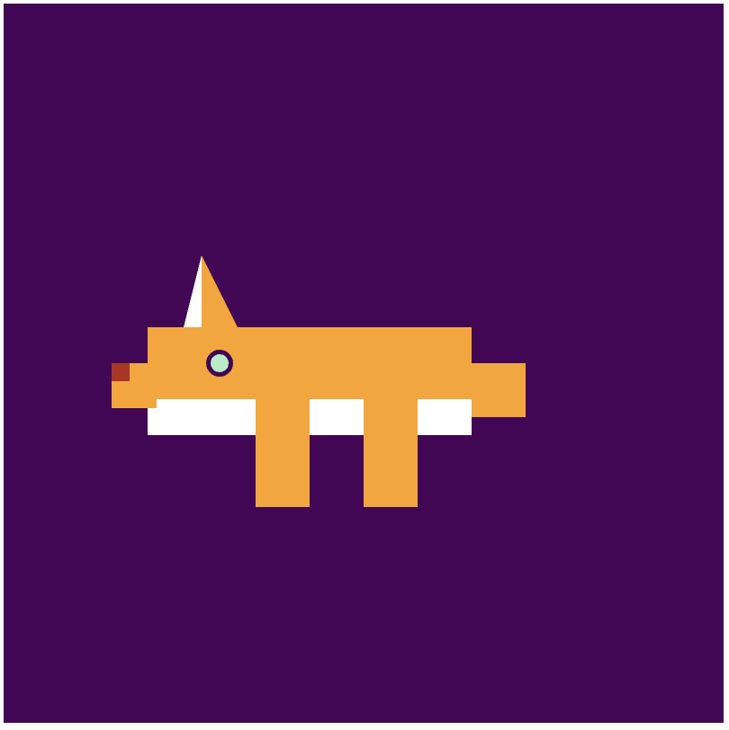
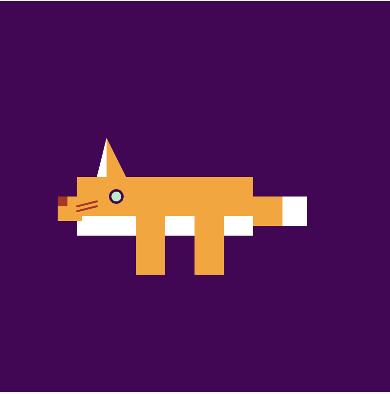
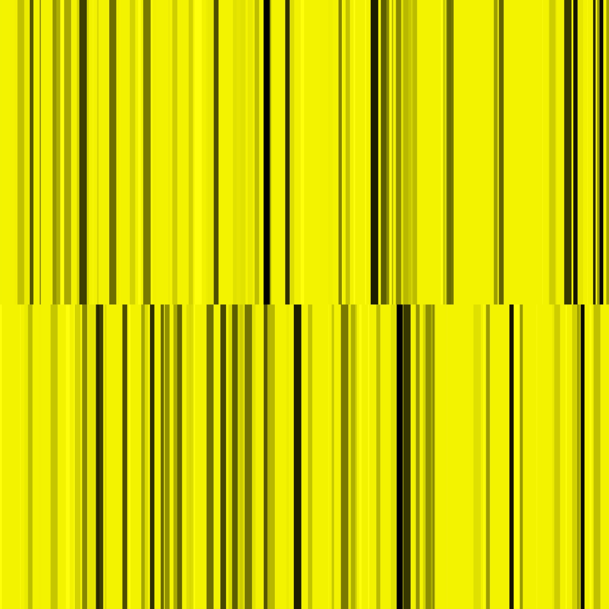
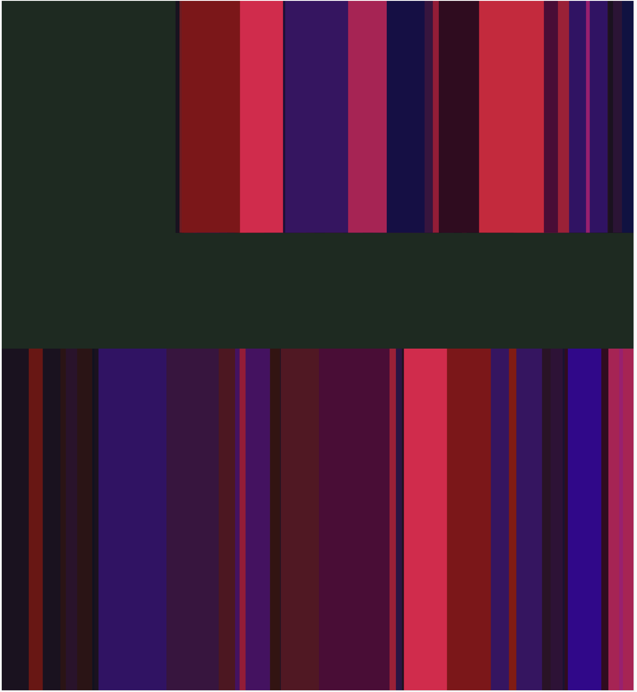
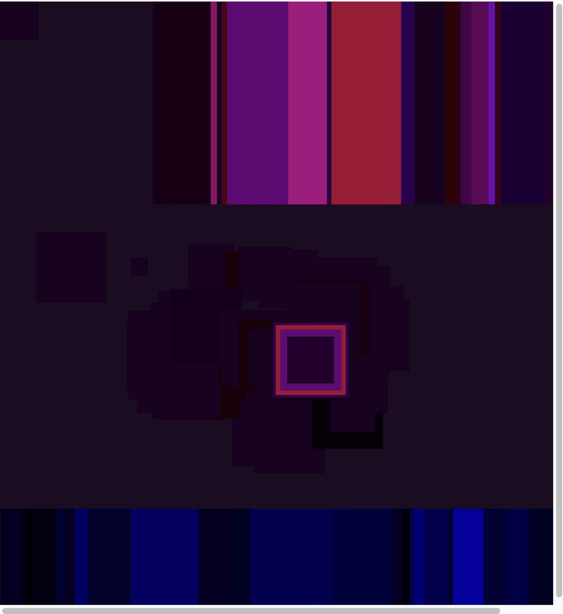
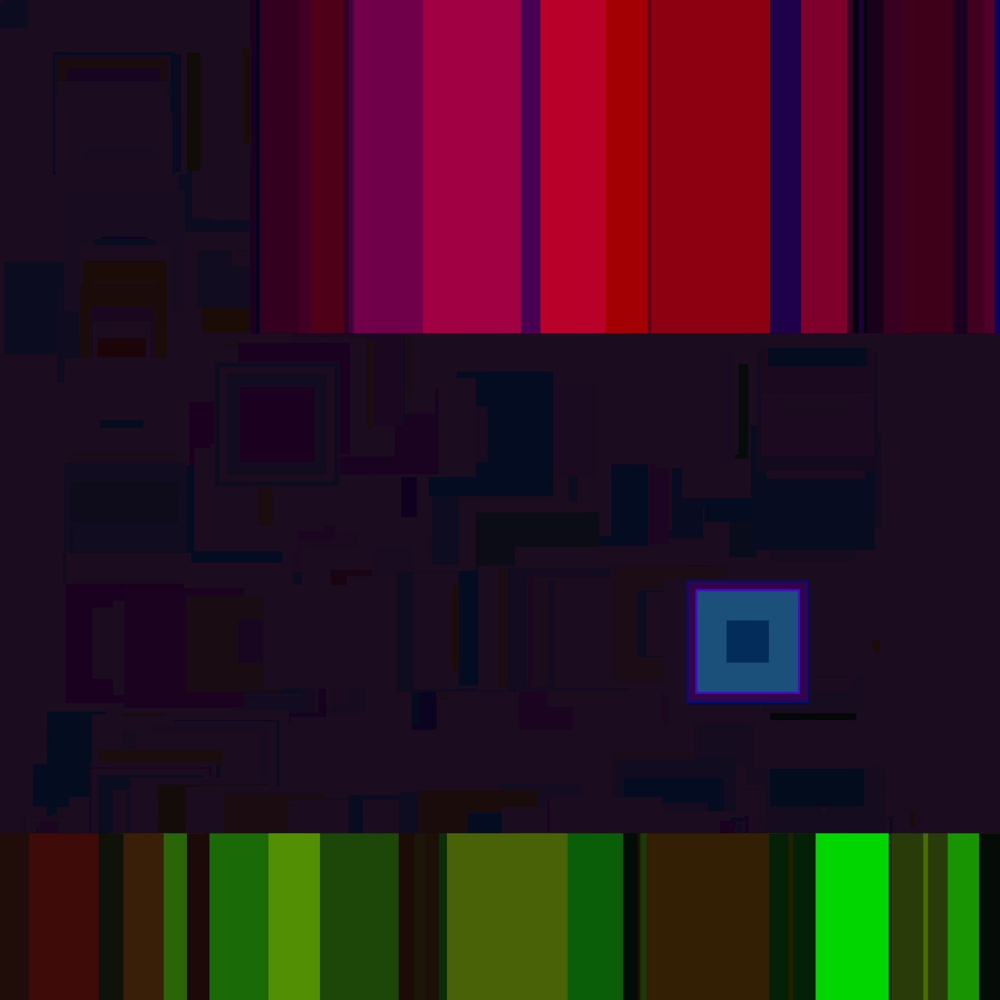

# Week 01 — Drawing with Code
<!-- Replace ## with the week number and Topic Name with the week's focus -->
<!-- You may also refer to each week's slide for the Topic Name -->
<!-- e.g. Week 03 — Arrays & Functions -->

---

### Activities

| Activity | What I Made                   |
| -------- | ----------------------------- |
| `1a`     | < A fox                     > |
| `1b`     | < A box in a field of colors> |

<!-- Add or remove rows to match the activities for this week. -->

---

### This Week

I have never done coding properly before, its all quite new. I think I got the hang of how images are drawn with simple shapes, although I think it will take some time to get used to with the draw point at the top left. Assignment 1 was fun. I tried to avoid using the help grid because I was stubborn.

For assigment 2 I chose to build on Ryoji Ikeda. I made a box and have it track the cursor. The drawing of the lower rectangle threw me off a bit, I think I kept mixing up the X and Y values. The format of colours I am not familar with either.
<!-- A short, informal summary of what you explored across the week's activities. What did you make? What clicked? What didn't?
     A few sentences is all you need — write it like a journal entry, not a report. -->

---

### Output










<!-- Drop a screenshot, photo, or GIF of something you made this week.
     Save it to a readme-assets/ folder inside this week's folder.
     Made more than one thing worth showing? Add more images. -->

---

<!-- ─────────────────────────────────────────────────────
     GOING FURTHER — if you want to document more, here are some ideas:

     ### 1a — Activity Name
     
     What you tried, what you discovered.

     ### 1b — Activity Name
     
     What you tried, what you discovered.

     ### 🧩 Something I Found Interesting
     A line of code, a technique, a happy accident — paste it here.
     ```js
     // your code here
     ```

     ### ❓ Questions I'm Sitting With
     Anything unresolved, something you want to revisit, or a rabbit hole you fell into.

     ### 🔗 References
     Links to anything that helped or inspired you this week.
     ───────────────────────────────────────────────────── -->
