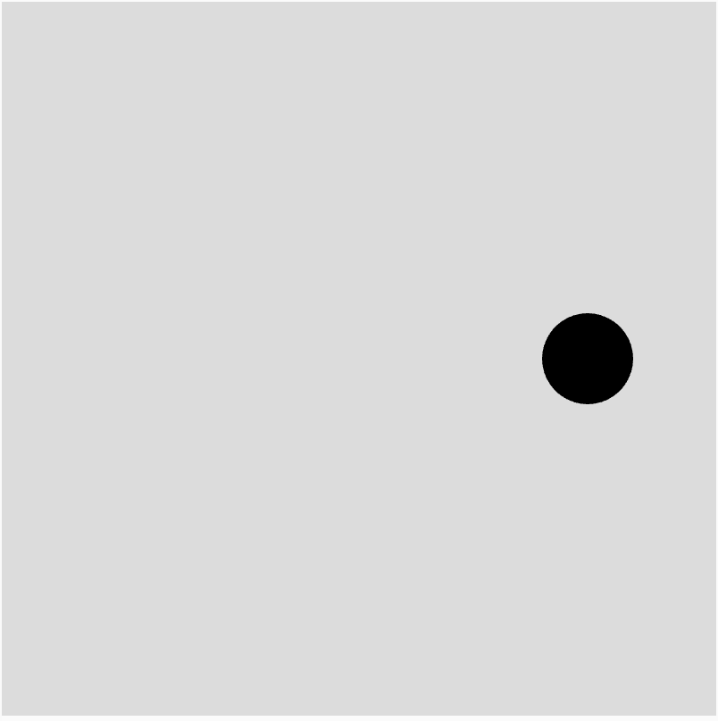
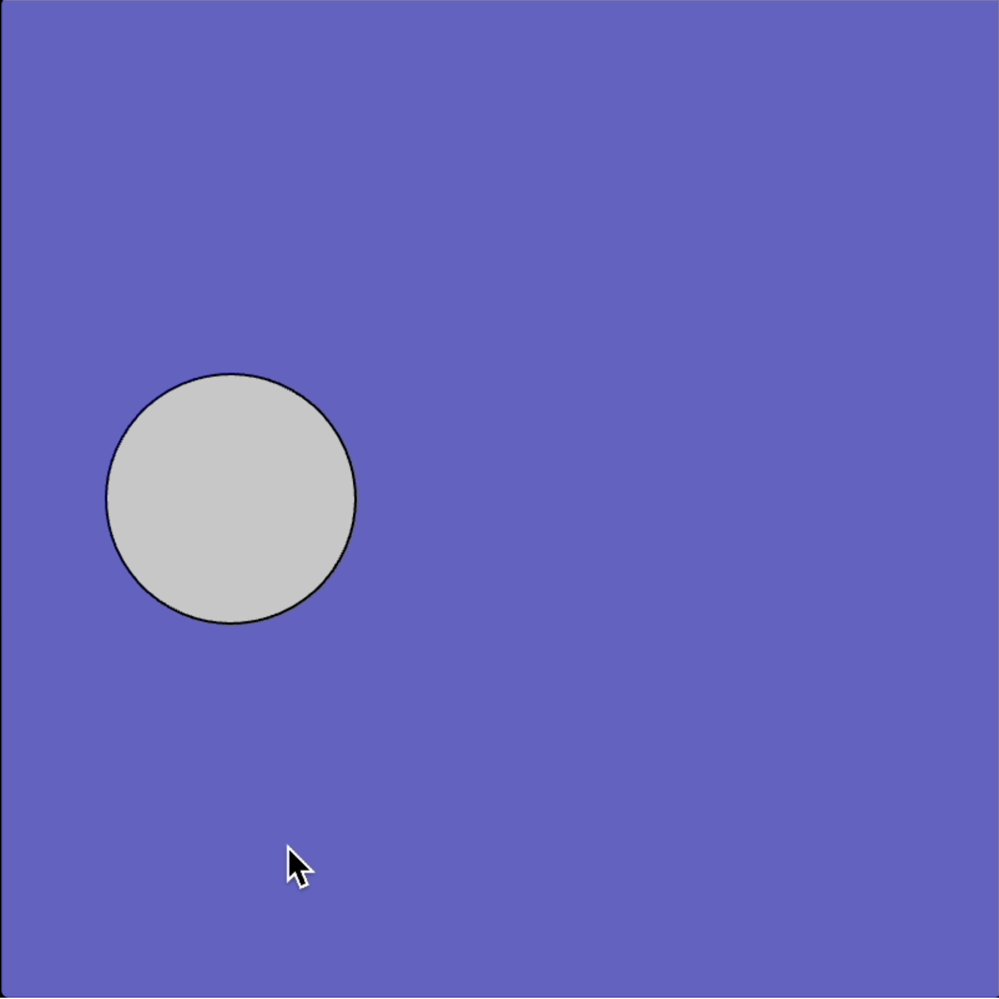
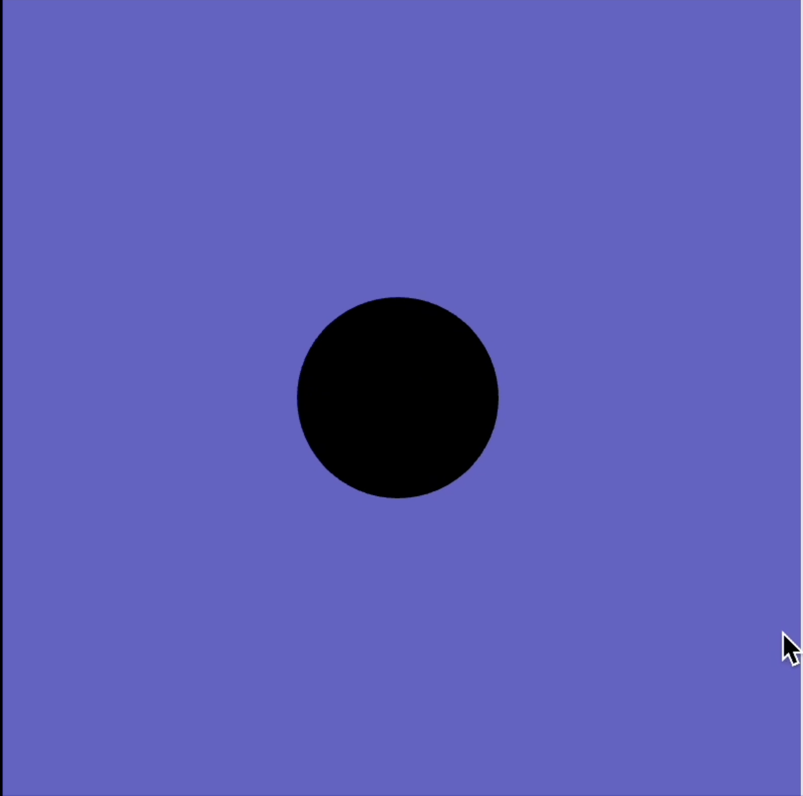
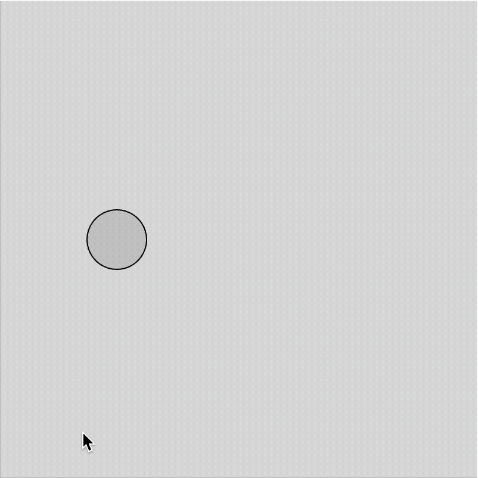
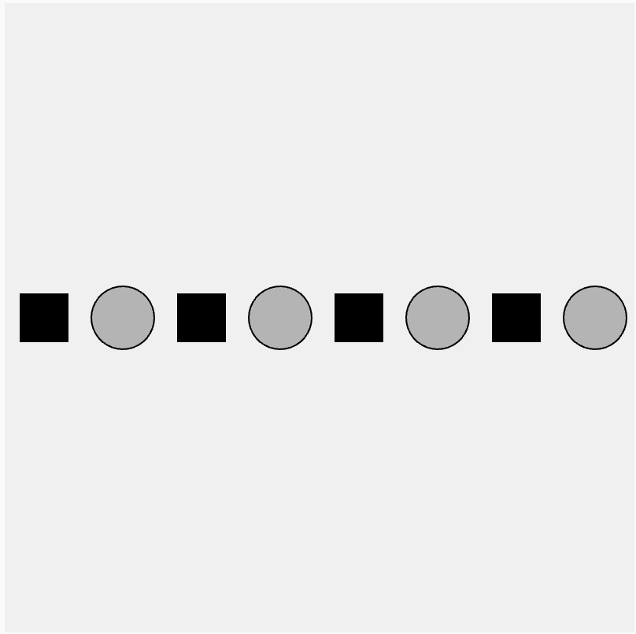
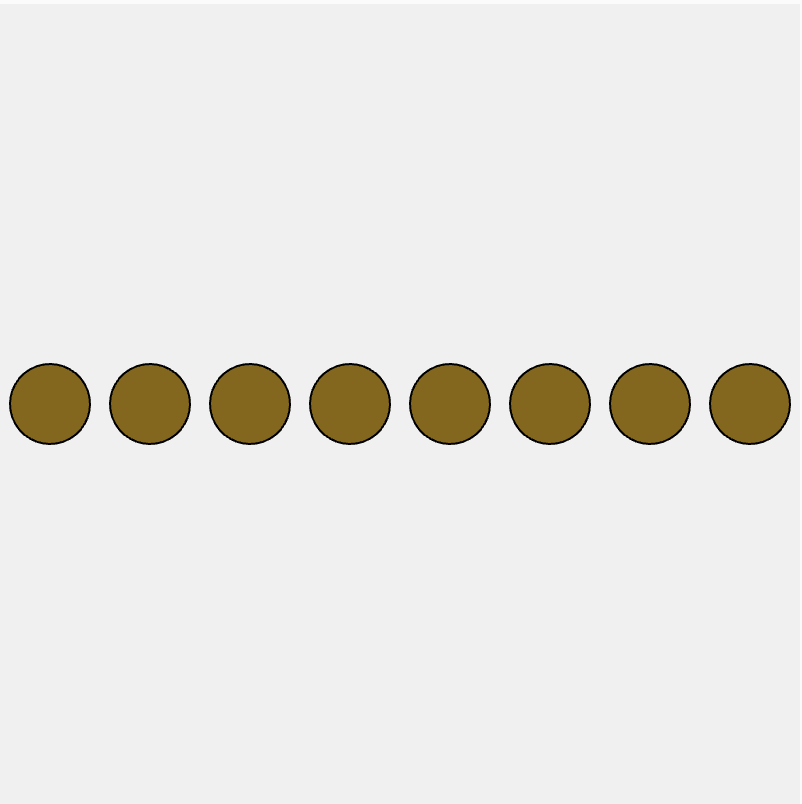
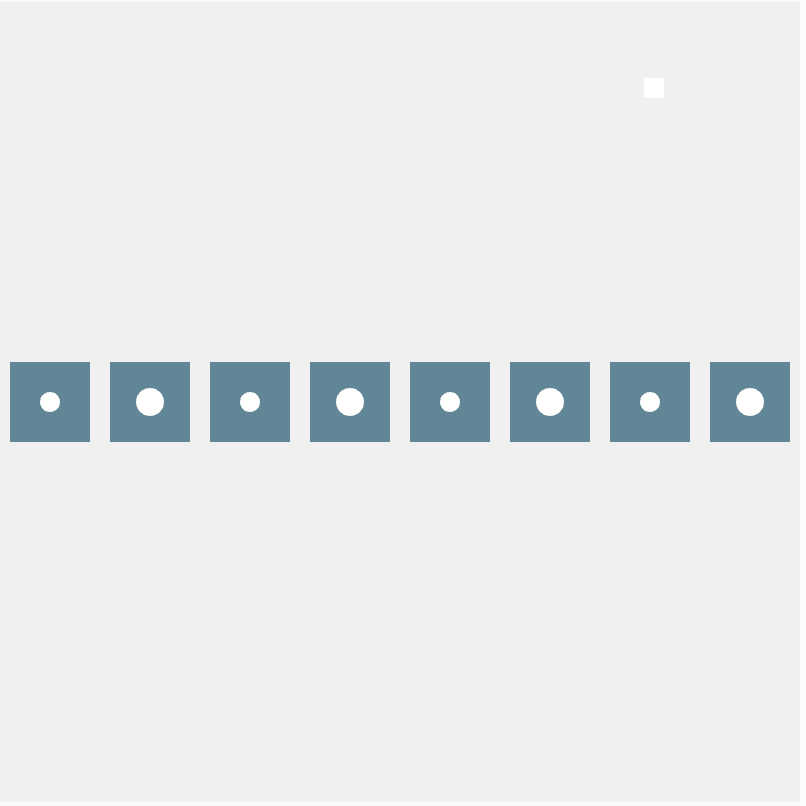
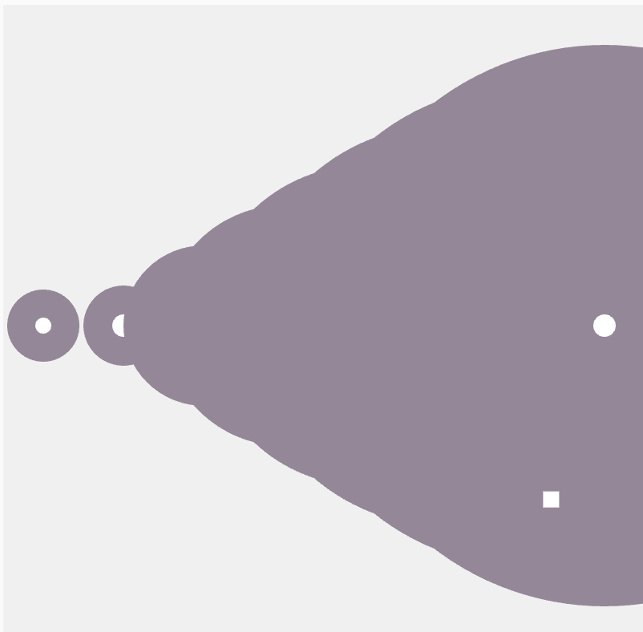
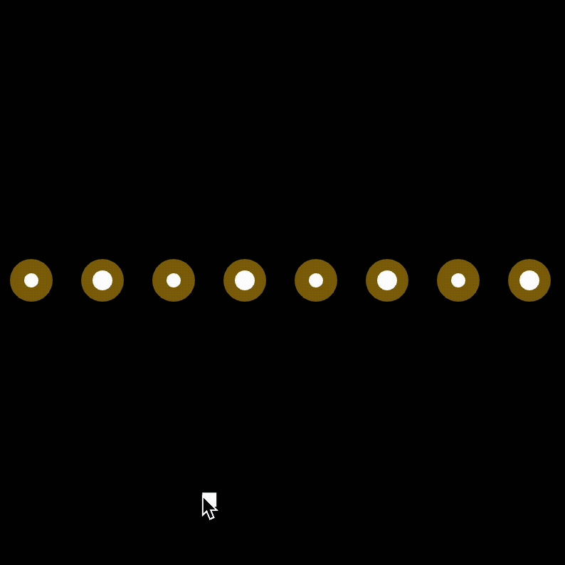

# Week 02 — Conditionals

---

### Activities

| Activity | What I Made                        |
| -------- | -----------------------------------|
| `2a`     | <    3 Mode Switch.              > |
| `2b`     | < Pattern Making, dancing shapes > |

<!-- Add or remove rows to match the activities for this week. -->

---

### This Week

The setup and draw as seperate features make sense. The conditionals are conceptually familiar as I have heard about it before through videos on videogames, if/else and switch/case.  I think i need to get used to the && or ||.

The mode switch was fun. I was able to get the hang of it.
	
 The for loop is really useful, but I dont think I understand precisely the maths behind it. for (let i = 0; i < numLines; i++)

For activitity 2b I wanted to have control over the shapes with the buttons and colour with the cursor. Mapping each corner to one colour type, like the 4 colour button toy simon-says.

<!-- A short, informal summary of what you explored across the week's activities. What did you make? What clicked? What didn't?
     A few sentences is all you need — write it like a journal entry, not a report. -->

---

### Output












<!-- Drop a screenshot, photo, or GIF of something you made this week.
     Save it to a readme-assets/ folder inside this week's folder.
     Made more than one thing worth showing? Add more images. -->

---

<!-- ─────────────────────────────────────────────────────
     GOING FURTHER — if you want to document more, here are some ideas:

     ### 1a — Activity Name
     
     What you tried, what you discovered.

     ### 1b — Activity Name
     
     What you tried, what you discovered.

     ### 🧩 Something I Found Interesting
     A line of code, a technique, a happy accident — paste it here.
     ```js
     // your code here
     ```

     ### ❓ Questions I'm Sitting With
     Anything unresolved, something you want to revisit, or a rabbit hole you fell into.

     ### 🔗 References
     Links to anything that helped or inspired you this week.
     ───────────────────────────────────────────────────── -->
