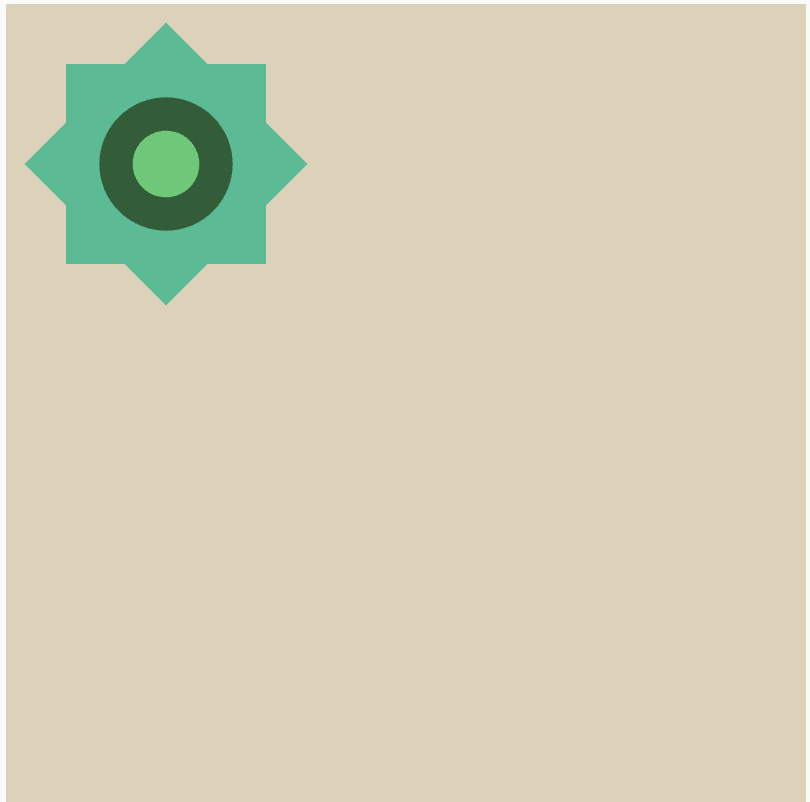
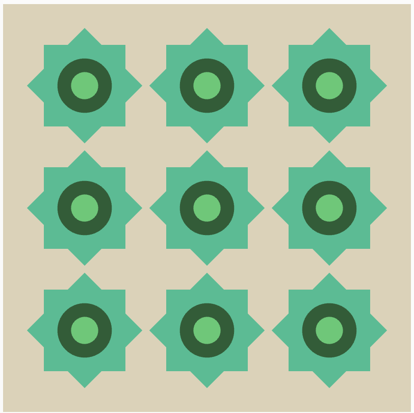

# Week 03 — Organizing code

---

### Activities

| Activity | What I Made                   |
| -------- | --------------------- |
| `3a`     | < Flickering Colors > |
| `3b`     | <   Desert Cactus   > |

<!-- Add or remove rows to match the activities for this week. -->

---

### This Week

The array can be very useful I think. I like that you can randomize it.
I think I dont yet fully grasp function, i guess when constructing a complex indepdendent object.

The rotation I think will be very handy, but its quite awkward trying to think how computers think. I can also see how useful push and pop can be, but I will have to experiment with it to understand it properly.

For activity 3b, I made a field of cactus, which I am quite proud of. I figured out the distance via x and Y changes between squares when rotation is a applied
<!-- A short, informal summary of what you explored across the week's activities. What did you make? What clicked? What didn't?
     A few sentences is all you need — write it like a journal entry, not a report. -->

---

### Output






<!-- Drop a screenshot, photo, or GIF of something you made this week.
     Save it to a readme-assets/ folder inside this week's folder.
     Made more than one thing worth showing? Add more images. -->

---

<!-- ─────────────────────────────────────────────────────
     GOING FURTHER — if you want to document more, here are some ideas:

     ### 1a — Activity Name
     
     What you tried, what you discovered.

     ### 1b — Activity Name
     
     What you tried, what you discovered.

     ### 🧩 Something I Found Interesting
     A line of code, a technique, a happy accident — paste it here.
     ```js
     // your code here
     ```

     ### ❓ Questions I'm Sitting With
     Anything unresolved, something you want to revisit, or a rabbit hole you fell into.

     ### 🔗 References
     Links to anything that helped or inspired you this week.
     ───────────────────────────────────────────────────── -->
