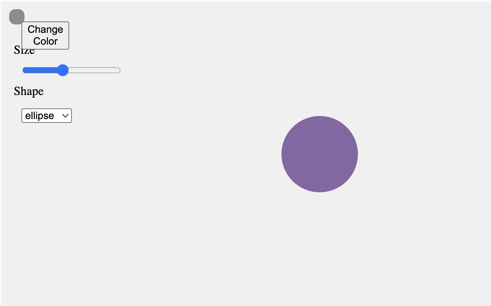
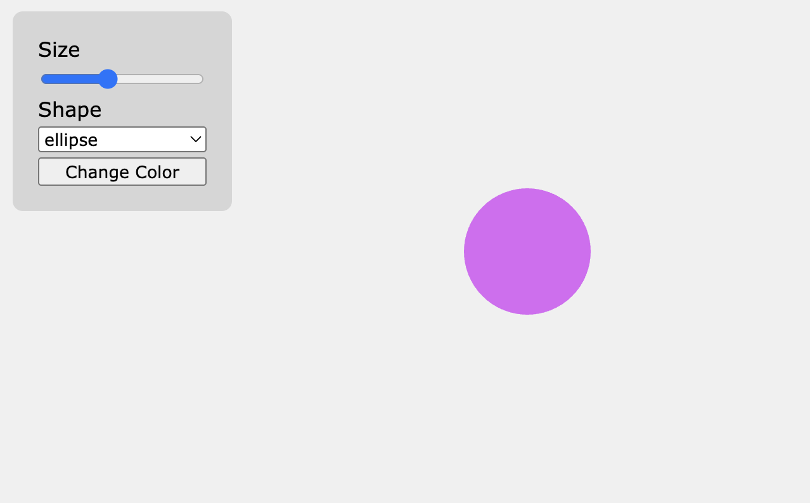
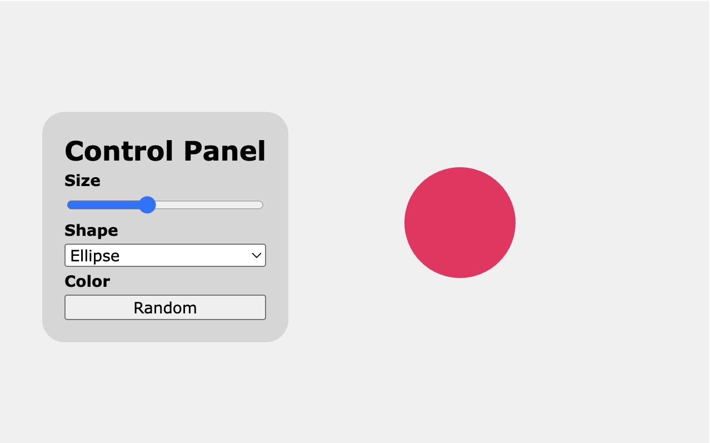

# Week 10 — Interface Design

---

### Activities

| Activity | What I Made         |
| -------- | ------------------- |
| `10`     | < Control Panel  > |


<!-- Add or remove rows to match the activities for this week. -->

---

### This Week

This was quite eye-opening for me, leaning that DOM elements are completely sepeare from the canvas level, which explained why we struggled with the fonts in our previous project. I have encountered styling UI through AI on various projects, but I did not know there was so many custom features... feel like you can keep on discovering new ways to make a button or slider.


<!-- A short, informal summary of what you explored across the week's activities. What did you make? What clicked? What didn't?
     A few sentences is all you need — write it like a journal entry, not a report. -->

---

### Output






<!-- Drop a screenshot, photo, or GIF of something you made this week.
     Save it to a readme-assets/ folder inside this week's folder.
     Made more than one thing worth showing? Add more images. -->

---

<!-- ─────────────────────────────────────────────────────
     GOING FURTHER — if you want to document more, here are some ideas:

     ### 1a — Activity Name
     
     What you tried, what you discovered.

     ### 1b — Activity Name
     
     What you tried, what you discovered.

     ### 🧩 Something I Found Interesting
     A line of code, a technique, a happy accident — paste it here.
     ```js
     // your code here
     ```

     ### ❓ Questions I'm Sitting With
     Anything unresolved, something you want to revisit, or a rabbit hole you fell into.

     ### 🔗 References
     Links to anything that helped or inspired you this week.
     ───────────────────────────────────────────────────── -->
